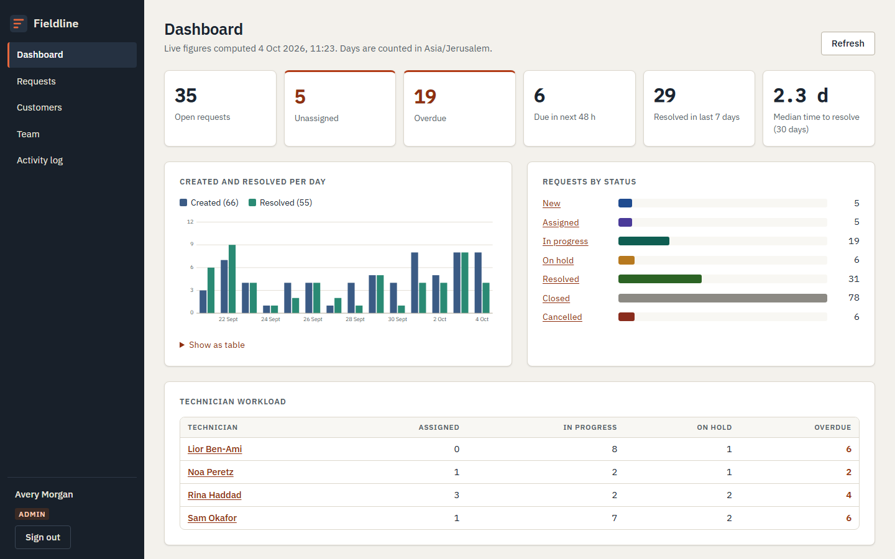
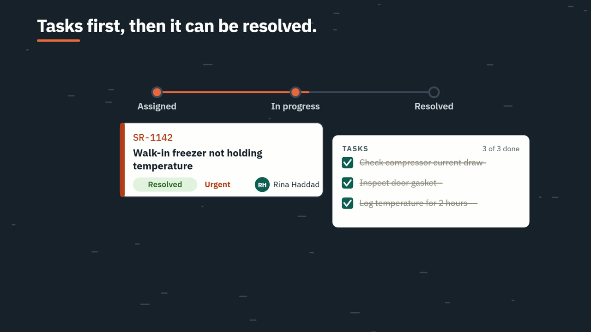
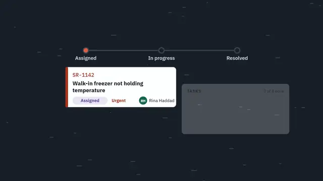
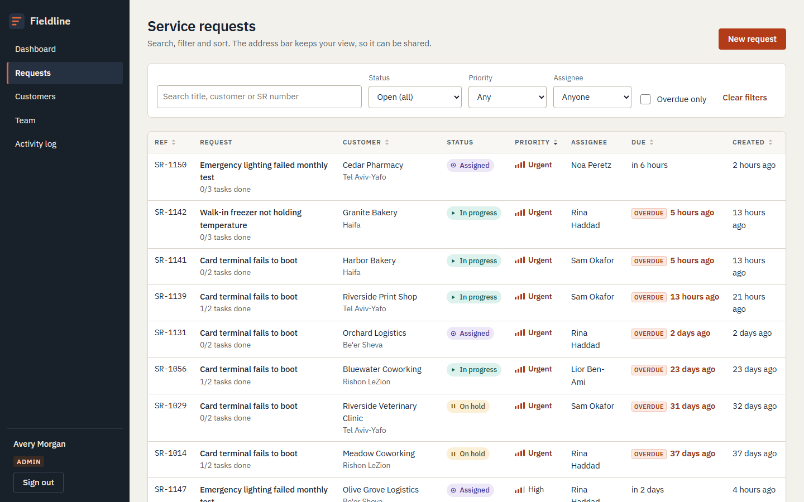
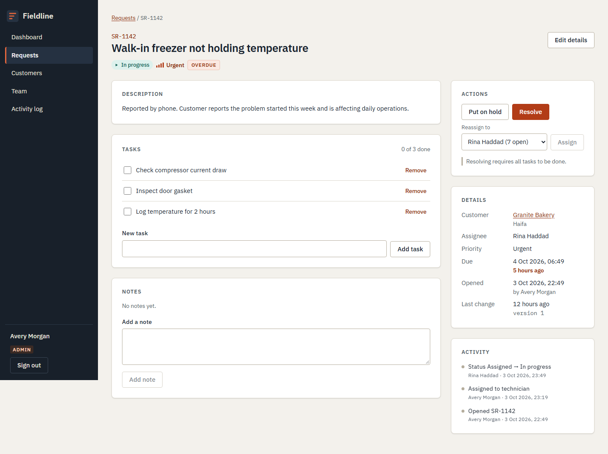
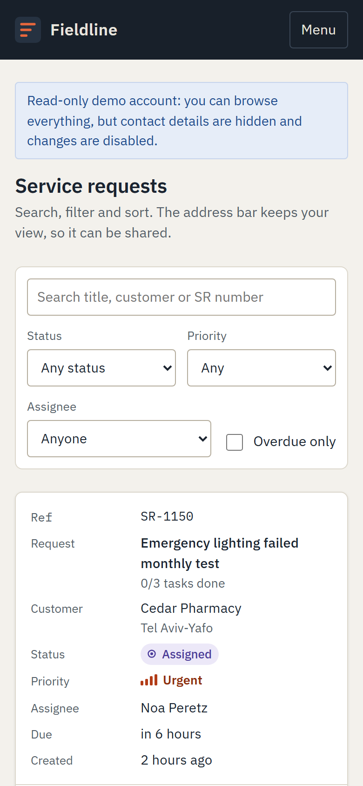

# Fieldline

Service request and field work management for a small maintenance team: customers, service requests, tasks,
technicians and a live dashboard, with role-based access enforced on the server.



**Specialisation shown:** Full Stack delivery of a business workflow, with authorisation and a relational data model
as the supporting skills.

## Product film

[](https://github.com/gad-rapaport/fieldline/releases/download/v0.1.0/fieldline-film.mp4)

22 seconds, no sound needed: a failing freezer becomes a request, is assigned, worked through its tasks, survives a
concurrent edit and is resolved. [Download or play the MP4](https://github.com/gad-rapaport/fieldline/releases/download/v0.1.0/fieldline-film.mp4)
(release asset; needs access to this repository while it is private). Made from code in [animation/](animation/):
[brief](docs/ANIMATION-BRIEF.md), [storyboard](docs/ANIMATION-STORYBOARD.md), [rendering](docs/ANIMATION-RENDERING.md).



## What it does

- Sign in and out with server-side sessions. Three roles: **admin**, **technician**, **viewer**.
- Create and edit customers and service requests; attach tasks and notes.
- Assign requests to technicians, or let a technician claim an unassigned request.
- Move requests through a status machine with legal transitions only
  (`new → assigned → in progress → on hold / resolved → closed`, plus cancel and reopen).
- Business rules: resolving needs every task done and a resolution note; closing and cancelling are admin
  decisions; closed requests are read-only.
- Search, filter, sort and paginate requests and customers. Filters live in the URL.
- Dashboard computed from the live tables: open work, overdue, created vs resolved per day, technician load.
- Activity log written in the same transaction as each change.
- Concurrent edits never overwrite silently: stale saves get a 409 with the current record and a side-by-side
  comparison in the UI.

| Requests                                   | Request detail                                 | Phone                                          |
| ------------------------------------------ | ---------------------------------------------- | ---------------------------------------------- |
|  |  |  |

## Engineering evidence

| Topic                                                 | Where                                                                                                                  |
| ----------------------------------------------------- | ---------------------------------------------------------------------------------------------------------------------- |
| Schema, constraints, justified indexes                | [server/migrations/001_init.sql](server/migrations/001_init.sql), [docs/ARCHITECTURE.md](docs/ARCHITECTURE.md#indexes) |
| Status machine and permission policy (pure functions) | [server/src/domain](server/src/domain)                                                                                 |
| Transactions, row locks, optimistic versions          | [server/src/modules/requests/service.ts](server/src/modules/requests/service.ts)                                       |
| Layering: routes, services, repositories              | [docs/ARCHITECTURE.md](docs/ARCHITECTURE.md#layers)                                                                    |
| Authorisation and permission tests                    | [tests/integration/permissions.test.ts](tests/integration/permissions.test.ts)                                         |
| Concurrency tests                                     | [tests/integration/concurrency.test.ts](tests/integration/concurrency.test.ts)                                         |
| E2E, keyboard and accessibility checks                | [tests/e2e](tests/e2e)                                                                                                 |

## Stack

TypeScript on Node.js 24, Fastify 5, PostgreSQL 18 (no ORM, parameterised SQL), Zod for input validation,
Argon2id password hashing, React 19 with React Router and Vite, hand-written CSS, IBM Plex fonts served locally.
Vitest and Playwright with axe-core for tests. Docker Compose for running, GitHub Actions for CI.
Reasons for each choice: [docs/DECISIONS.md](docs/DECISIONS.md).

## Quick start

Requirements: Docker Desktop (or Docker Engine with Compose v2) and PowerShell 7.

```powershell
./scripts/ops.ps1 setup     # creates .env with random secrets, builds, starts, seeds
```

Open **http://127.0.0.1:8101**. Without PowerShell, see the plain Docker commands in [docs/SETUP.md](docs/SETUP.md).

### Demo accounts

| Role       | Email                                                | Can                                                              |
| ---------- | ---------------------------------------------------- | ---------------------------------------------------------------- |
| Admin      | `admin@fieldline.test`                               | Everything, including assignment, closing and the activity log   |
| Technician | `noa@fieldline.test` (also `sam@`, `lior@`, `rina@`) | Create requests and customers, claim and work their own requests |
| Viewer     | `viewer@fieldline.test`                              | Read-only; customer contact details are hidden                   |

Passwords are generated per installation and stored only in the local `.env` (`SEED_*_PASSWORD`).

## Everyday commands

```powershell
./scripts/ops.ps1 start | stop | status | logs app | seed | backup | test
./scripts/ops.ps1 restore backups/<file>.dump -Yes
./scripts/ops.ps1 reset-demo -Yes      # wipes and re-seeds; asks for -Yes first
```

`stop` removes containers but keeps the database volume.

## Tests

| Suite                                                                                  | Count | Command                    |
| -------------------------------------------------------------------------------------- | ----- | -------------------------- |
| Unit (domain rules, validation, query building)                                        | 27    | `npm run test:unit`        |
| Integration (real PostgreSQL: auth, permissions, workflow, concurrency, seed, hosting) | 49    | `npm run test:integration` |
| E2E (Chromium desktop and phone, axe-core)                                             | 8     | `npm run test:e2e`         |

Details, scenarios and coverage gaps: [docs/TESTING.md](docs/TESTING.md).

## Documentation

[Architecture](docs/ARCHITECTURE.md) · [Decisions](docs/DECISIONS.md) · [Setup](docs/SETUP.md) ·
[API](docs/API.md) · [Security](docs/SECURITY.md) · [Testing](docs/TESTING.md) ·
[Operations](docs/OPERATIONS.md) · [Deployment](docs/DEPLOYMENT.md) · [Design](docs/DESIGN.md) ·
[Demo script](docs/DEMO.md) · [Exercises](docs/EXERCISES.md) · [Slim profile](docs/SLIM.md) ·
[Storage](docs/STORAGE.md) · [Changelog](CHANGELOG.md)

## Limitations

- Single-tenant demo: no user management screens; accounts come from the seed.
- No email or push notifications.
- Sessions are server-side rows; there is no "sign out everywhere" button yet.
- Built for a few thousand requests. Offset pagination and per-day dashboard subqueries would need revisiting
  for much larger data (see [docs/DECISIONS.md](docs/DECISIONS.md)).

All data is synthetic. People, companies, emails (`.test` / `.example` domains) and phone numbers are fictional.
No licence has been chosen for this code yet; third-party licences are listed in [docs/DESIGN.md](docs/DESIGN.md#assets-and-licences).
