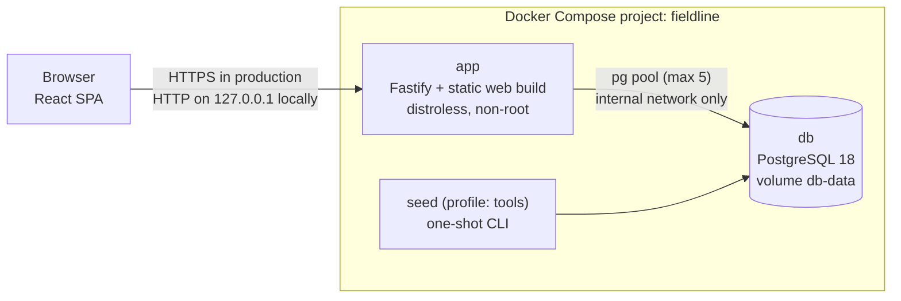
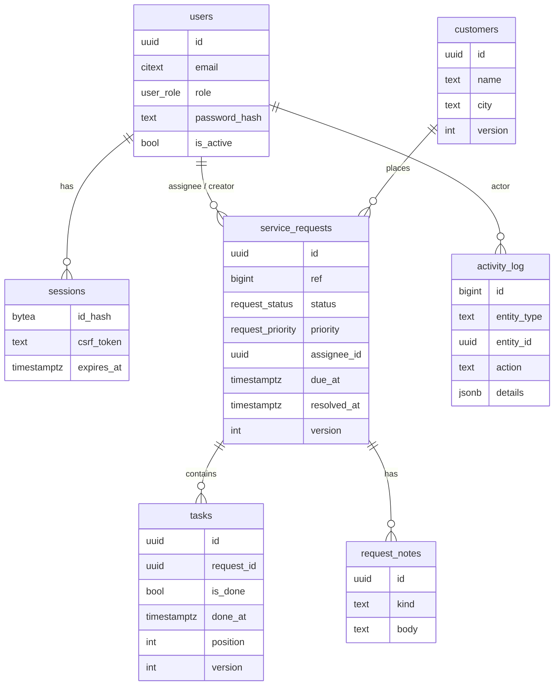

# Architecture

## Components



- One application container serves both the JSON API (`/api/*`) and the built React app. Same origin means no
  CORS configuration and SameSite cookies work as intended.
- PostgreSQL sits on an `internal: true` network with no published port. Only the app and the one-shot seed
  container can reach it.
- The seed and reset commands reuse the app image through a Compose profile, so the running app never holds the
  demo account passwords.

## Layers

```
server/src
  http/         auth hook (session + CSRF), validation helpers, request typing
  domain/       pure rules: status machine, permission policy, error types
  modules/
    <feature>/routes.ts    HTTP: parse input with Zod, call a service, shape the response
    <feature>/service.ts   business operations: transactions, locks, rule checks, activity log
    <feature>/repo.ts      SQL only: parameterised queries, whitelisted sort clauses
  db/           pool, transaction helper, migration runner, seed
web/src
  api/          fetch wrapper (CSRF header, error mapping) and response types
  pages/        one component per screen
  components/   layout, badges, fields, dialogs, states
```

Rules live in `domain/` as plain functions with no I/O, so they are unit tested directly
([tests/unit/domain.test.ts](../tests/unit/domain.test.ts)). Services combine them with data access. The UI
never re-implements permissions: the request detail endpoint returns `allowed` actions computed by the same
policy the server enforces, and a unit test checks that every offered action would be accepted.

## Data model



Invariants enforced by the database as a last line of defence (the service layer checks them first and returns
friendly errors):

- `service_requests_assignee_matches_status`: `new` has no assignee; working statuses must have one.
- `service_requests_resolved_at_matches_status`: `resolved_at` is set exactly for resolved and closed requests.
- `tasks_done_at_matches_flag`, length checks on text columns, enum types for status, priority and role.
- `customers_name_city_uq`: one customer per name and city (case-insensitive).

## Indexes

| Index                                                           | Query it serves                                                        | Why this shape                                                              |
| --------------------------------------------------------------- | ---------------------------------------------------------------------- | --------------------------------------------------------------------------- |
| `service_requests (status, created_at DESC)`                    | Request list filtered by status, newest first; dashboard status counts | Equality column first, then the default sort.                               |
| `service_requests (assignee_id, status)`                        | Technician queue, workload aggregation                                 | Both columns are always filtered together.                                  |
| `service_requests (customer_id, created_at DESC)`               | Customer detail history                                                | Avoids a sort for the "recent requests" panel.                              |
| `service_requests (due_at) WHERE status IN open`                | Overdue and due-soon counts                                            | Partial: closed work never matters for due dates, so the index stays small. |
| `gin (title gin_trgm_ops)`, `gin (customers.name gin_trgm_ops)` | `ILIKE '%term%'` search                                                | A B-tree cannot serve a leading wildcard; trigram GIN can.                  |
| `tasks (request_id, position)`                                  | Task list per request                                                  | Matches the ORDER BY.                                                       |
| `activity_log (entity_type, entity_id, id DESC)`                | Timeline of one request                                                | Newest first without a sort.                                                |
| `activity_log (actor_id, id DESC)`                              | Admin filter by person                                                 |                                                                             |
| `sessions (expires_at)`                                         | Hourly purge of expired sessions                                       |                                                                             |

At demo size (150 requests) PostgreSQL may still choose sequential scans; the indexes are sized for the access
patterns, not for the seed.

## Request flow: resolving a request

```mermaid
sequenceDiagram
  participant UI
  participant Route as routes.ts
  participant Svc as service.ts
  participant DB as PostgreSQL
  UI->>Route: POST /api/requests/:id/transition {expectedVersion, to: resolved, note}
  Route->>Route: Zod validation
  Route->>Svc: transitionRequest(actor, ...)
  Svc->>DB: BEGIN; SELECT ... FOR UPDATE
  Svc->>Svc: role gate, version check, legal transition, policy, note required
  Svc->>DB: count open tasks (task writers hold FOR SHARE, so this count is stable)
  Svc->>DB: UPDATE ... version = version + 1; INSERT note; INSERT activity_log
  Svc->>DB: COMMIT
  Svc-->>UI: updated request, tasks, notes, allowed actions
```

## Concurrency model

- **Lost updates between users** are prevented with optimistic versions. Every editable row has `version`; the
  client sends `expectedVersion`, the UPDATE includes `WHERE version = $expected`, and a mismatch returns 409
  with the current record.
- **Cross-row rules** (no resolve while a task is open) use row locks: status changes take `FOR UPDATE` on the
  request, task changes take `FOR SHARE` on the parent. The two lock modes conflict, so a task cannot be
  reopened between the open-task count and the status update. `READ COMMITTED` is enough because the lock, not
  the isolation level, provides the guarantee. See [DECISIONS.md](DECISIONS.md#concurrency).
- Migrations take a PostgreSQL advisory lock so two starting containers cannot apply them twice.

## Background work

- Expired sessions are purged hourly by a timer in the app process (`setInterval`, unref'd). No external
  scheduler is needed for one idempotent DELETE.
